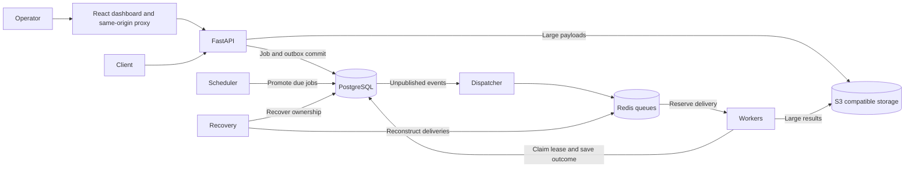

# Forge

Forge is an API-driven distributed job execution platform built from first
principles. It is designed to demonstrate durable acceptance, at-least-once
execution, retry and recovery behavior, scheduling, concurrency control, and
observable failure handling.

The durable execution path, retries, scheduling, cancellation, dead-letter replay,
worker recovery, and the React operations dashboard are implemented. Design decisions live in
[`docs/architecture-decisions.md`](docs/architecture-decisions.md).

Run the entire backend acceptance sequence with
`uv run python scripts/validate_backend.py`. It includes all tests, deployment,
dependency outages, worker recovery, capacity probes and 100,000 HTTP-submitted
jobs. See [the acceptance guide](docs/backend-acceptance.md),
[the operations runbook](docs/operations-runbook.md), and
[the dashboard API contract](docs/backend-api-contract.md).

## Run Forge

```powershell
uv sync --frozen
uv run python scripts/start_forge.py
```

Open **http://127.0.0.1:13010** for the dashboard. Use the dedicated key creation
command in the [dashboard guide](docs/dashboard.md) to connect. The same guide
explains every screen, scopes, live updates, local frontend development and tests.
The API is at port 18080; Grafana is at port 13000. Docker must be running with
its Linux engine. These commands preserve local databases and do not rerun the
long endurance benchmark.

Backend and dashboard checks run in [GitHub Actions](.github/workflows/ci.yaml).
The original throughput and enqueue-to-claim targets remain unmet; the
[measured evidence](docs/benchmarks/2026-10-05-backend-acceptance.md) records both
successful correctness checks and failed performance probes.

## Development prerequisites

- Python 3.14
- uv
- Docker with Docker Compose
- Node.js 24 and npm for dashboard development (Docker builds it otherwise)

## Architecture



PostgreSQL commits acceptance before the API responds. Redis delivers work,
while database attempt leases determine who can finish it. See the
[architecture decisions](docs/architecture-decisions.md) for the reasoning.

## Redis keys

| Key | Type and purpose |
|---|---|
| `forge:queue:{high,normal,low}` | Lists: FIFO runnable deliveries per tier |
| `forge:processing:{worker_id}` | List: that worker's reserved deliveries |
| `forge:worker:{worker_id}:heartbeat` | Expiring heartbeat, default 15-second TTL |
| `forge:permits:{job_type}` | Sorted set: leased global concurrency permits |
| `forge:rate-limit:{public_id}` | Sorted set: API-key sliding request window |

Scheduling, dead letters and submission idempotency are PostgreSQL records.
They are not represented by authoritative delayed, DLQ or deduplication Redis keys.

## Accepted tradeoffs

- Execution is at least once. Submission idempotency prevents duplicate jobs;
  a handler or downstream service must prevent duplicate external side effects.
- PostgreSQL is the durability layer. Redis recovery reconstructs deliveries
  with a delay and can cause another attempt after ownership expires.
- Attempt leases, not heartbeat expiry alone, determine when another worker
  can own work. The default lease is 30 seconds; recovery polls every second.
- Cancellation and thread shutdown are cooperative. Already performed external
  effects cannot be undone, and an uncooperative handler may finish.
- Priority weights guarantee opportunities for lower tiers, not a fixed start deadline.
- Large objects introduce a second storage dependency. Retention exports are
  not complete disaster-recovery backups.
- Throughput and latency are measured properties of a specific deployment.
  The draft PRD's 1,000/sec and enqueue-to-claim targets are not promises.

The draft PRD used different coordination mechanisms and overstated what
submission idempotency could guarantee after a crash. The accepted architecture
decisions supersede those details. See the
[completion audit](docs/backend-completion-audit.md) and
[benchmark evidence](docs/benchmarks/) for implemented behavior and limits.

## Production containers

[`deploy/Dockerfile`](deploy/Dockerfile) builds one non-root, read-only-capable
image for every Forge process. Copy `.env.production.example` to
`.env.production`, replace every placeholder, build the image, and run the
migration gate before starting services:

```powershell
Copy-Item .env.production.example .env.production
docker compose -f deploy/compose.production.yaml build
docker compose -f deploy/compose.production.yaml up -d api dispatcher worker scheduler recovery maintenance
```

Scale stateless processes with Compose's `--scale`, for example
`--scale worker=4`. PostgreSQL connections are pooled separately in every
process. Budget for at most
`(FORGE_POSTGRES_POOL_SIZE + FORGE_POSTGRES_MAX_OVERFLOW) × process count`
connections, plus migration and administrative connections.

The production Compose file expects PostgreSQL, Redis, and S3-compatible object
storage to be supplied externally. It does not embed development credentials or
publish dependency ports.
Each process waits for a successful migration. Container logs rotate at 10 MB
with three files per process. Worker grace exceeds the configured drain deadline.

Export the committed API contract after an intentional route or schema change
with `uv run python scripts/export_openapi.py`. Contract tests fail when the
application and [`docs/openapi.json`](docs/openapi.json) drift apart.

## Local API

```powershell
Copy-Item .env.example .env
docker compose up -d postgres redis object-store
uv sync
uv run forge-api
```

Run the transactional outbox dispatcher in a separate terminal:

```powershell
uv run forge-dispatcher
```

Run one or more workers in additional terminals:

```powershell
uv run forge-worker
```

Each worker runs up to `FORGE_WORKER_CONCURRENCY` jobs concurrently. The JSON
object in `FORGE_JOB_TYPE_CONCURRENCY_LIMITS` applies a shared limit across all
workers for selected job types. These Redis-backed permits are leased and
renewed, so capacity returns automatically when a worker disappears.

The API rejects new submissions with `503 system_overloaded` and a `Retry-After`
header when the durable outstanding backlog reaches
`FORGE_ADMISSION_BACKLOG_LIMIT`. An idempotent retry of an already accepted job
still returns that job while admission is closed.

Each API process also admits at most
`FORGE_API_SUBMISSION_CONCURRENCY_LIMIT` simultaneous submission or replay
requests before authentication performs a database lookup. Excess requests
receive `503 submission_capacity_exceeded` with `Retry-After`; clients can retry
them because Forge has not accepted a job. The default is six against a
ten-connection API pool, leaving four connections available for health, status,
and administrative requests.

Every authenticated endpoint also applies the request limit stored on its API
key. Successful responses include `X-RateLimit-Limit` and
`X-RateLimit-Remaining`; exhausted keys receive `429 rate_limit_exceeded` with
`Retry-After`. The sliding window is coordinated through Redis across API
processes.

HTTP request bodies are capped by `FORGE_MAX_REQUEST_BODY_BYTES` (10 MB by
default). Validated job payloads and results are serialized to canonical JSON;
values above `FORGE_MAX_INLINE_PAYLOAD_BYTES` (256 KB by default) are stored in
the configured S3-compatible object store. API responses expose storage flags
without revealing internal object keys. The local Compose service uses
SeaweedFS because MinIO Community Edition and its public images were retired in
2026.

Run the scheduler to promote due scheduled and retrying jobs:

```powershell
uv run forge-scheduler
```

Run recovery to handle expired worker leases:

```powershell
uv run forge-recovery
```

Recovery also reconstructs queued Redis deliveries from PostgreSQL every
`FORGE_DELIVERY_RECONCILIATION_INTERVAL_SECONDS`. Reconstructed duplicates are
safe because the database attempt claim permits only one current owner.

Dispatcher, scheduler, worker, recovery, and maintenance processes handle
`SIGINT` and `SIGTERM`. They stop accepting new work, finish their current
database operation, and close connections. Workers keep their heartbeat and
attempt leases while draining already claimed jobs for up to
`FORGE_WORKER_DRAIN_TIMEOUT_SECONDS`. At the deadline, local job tasks are
cancelled and lease renewal stops so recovery can safely retry unfinished work.
The container grace period should be longer than this deadline so the runtime
has time to release permits and close connections.

All entry points emit JSON logs. Fields named for credentials, secrets, tokens,
payloads, or results are recursively redacted, and API-key or Bearer values
embedded in text are masked. Temporary PostgreSQL, Redis, and object-store
client failures return `503 dependency_unavailable` without exposing connection
details.

Run maintenance to remove idempotency records after
`FORGE_IDEMPOTENCY_RETENTION_HOURS`, archive successful/cancelled jobs after
`FORGE_SUCCESSFUL_JOB_RETENTION_DAYS`, archive failed/dead-lettered jobs after
`FORGE_FAILED_JOB_RETENTION_DAYS`, and delete unreferenced payload/result objects
after `FORGE_ORPHAN_OBJECT_GRACE_HOURS`:

```powershell
uv run forge-maintenance
```

Archives are stored as gzip-compressed JSON at
`archives/jobs/<job-id>.json.gz` with the job, its attempts, and its transition
history. The database row is deleted only after the archive upload succeeds.
Jobs that are still referenced as replay sources are retained until those
references no longer exist.

The public liveness endpoint is available at `GET /health`; `GET /ready` checks
PostgreSQL, Redis, and the object store.

## First administrator key

Set `FORGE_API_KEY_PEPPER` in `.env`, apply the database migration, and create
the first key from the trusted local shell:

```powershell
uv run alembic upgrade head
uv run forge key create --name "local admin" --scope admin
```

The CLI prints the credential once. Send it as an opaque API key, not as a JWT:

```http
Authorization: Bearer forge_live_<public-id>_<secret>
```

An administrator can create later scoped credentials through
`POST /v1/admin/api-keys`.

Administrators can inspect key metadata with `GET /v1/admin/api-keys` and revoke
a credential with `POST /v1/admin/api-keys/{api_key_id}/revoke`. Listing supports
UUIDv7 cursor pagination plus `enabled` and `scope` filters. Revocation is
idempotent, immediately blocks authentication, and writes one audit event.

## Job API

Authenticated clients use these job endpoints:

- `POST /v1/jobs` submits a job.
- `GET /v1/jobs` lists visible jobs using UUIDv7 cursor pagination and optional
  `status`, `type`, and `priority` filters.
- `GET /v1/jobs/{job_id}` returns one job.
- `GET /v1/jobs/{job_id}/result` retrieves its result transparently from
  PostgreSQL or object storage.
- `GET /v1/jobs/{job_id}/attempts` returns its execution attempts in attempt order.
- `GET /v1/jobs/{job_id}/transitions` returns its state-change timeline in
  chronological order.
- `POST /v1/jobs/{job_id}/cancel` cancels queued work or requests cooperative
  cancellation from its worker.
- `POST /v1/jobs/{job_id}/replay` creates a linked job from a dead-lettered job.

`GET /v1/handlers` returns the deployed handler catalog, including every
version's active state, execution mode, timeout, default attempt limit, and JSON
Schema payload contract.

Set `limit` from 1 to 100 on the list endpoint. When `next_cursor` is present in
the response, pass it as `cursor` to fetch the next page.

## Security audit log

Forge writes API-key creation, cancellation requests, and dead-letter replays to
an append-only `audit_events` table in the same transaction as each action. The
records retain the actor's public API-key identifier but never store credentials
or secrets.

Administrators query the log through `GET /v1/admin/audit-events`. The endpoint
supports `action`, `resource_type`, and `actor_public_id` filters plus `limit`
and identity-based cursor pagination.

## Operational API

Dashboard data is available to administrator keys through these read-only
endpoints:

- `GET /v1/admin/operations/summary` returns job-state totals, durable
  outstanding work, active workers, and queue totals.
- `GET /v1/admin/operations/queues` compares PostgreSQL's durable outstanding
  count with Redis priority and worker-processing queue depths.
- `GET /v1/admin/operations/workers` reports live heartbeat TTL, active database
  attempts, and reserved Redis messages for each worker.
- `GET /v1/admin/operations/performance?window_minutes=60` reports throughput,
  outcomes, retries, and p50/p95 queue-wait, execution-time, scheduling-lag,
  database-claim and end-to-end
  distributions for a bounded time window.
- `GET /v1/admin/operations/metrics` exposes authenticated, low-cardinality
  Prometheus gauges for durable state, queues, worker health, five-minute job
  rates and failure ratio, dead-letter volume, and job-type permit utilization.
- `GET /v1/admin/operations/events` streams job transitions as authenticated
  server-sent events. Pass `after=<transition-id>` to resume after a disconnect.

HTTP requests accept and return W3C `traceparent`. Forge carries the trace ID
through the durable outbox and Redis message, then binds a new worker span so
API, dispatcher, and worker JSON logs can be correlated without storing request
bodies or credentials.

Set `FORGE_OTLP_TRACING_ENABLED=true` and configure
`FORGE_OTLP_TRACES_ENDPOINT` to export batched API and worker spans over OTLP
HTTP. Sampling is controlled by `FORGE_TRACE_SAMPLE_RATIO`; tracing remains off
by default.

Run `uv run python scripts/start_observability.py` to start the validation
topology with Prometheus, a provisioned Forge dashboard in Grafana, and Tempo.
The script creates a dedicated local scrape credential without committing it.
See [the observability guide](docs/observability.md) for endpoints, metric
semantics, token rotation, and shutdown commands.

Run `uv run python scripts/validate_deployment.py` for the complete local
deployment acceptance check. It starts the topology, creates and later revokes a
temporary load-test key, runs the measured k6 workload, waits for every accepted
job, and verifies services, queues, startup dependencies, and database
integrity. See [the deployment-validation guide](docs/deployment-validation.md)
for its pass criteria, report locations, and configuration options.

Run `uv run python scripts/validate_dependency_outages.py` on an idle local
validation stack to reproduce PostgreSQL and object-storage loss and recovery.
It restores each dependency, checks accepted-job completion and bounded error
responses, verifies that Forge processes survive, and restores normal blob
settings afterward. The deployment-validation guide documents the experiments.

After migrations, `uv run python scripts/check_startup.py` verifies the Alembic
head, PostgreSQL, Redis, object storage, and handler registry. Capture real query
plans after seeding or load testing with
`uv run python scripts/explain_operations.py`; output is kept under ignored test
reports so local plans are not presented as portable benchmark evidence.

These values are operational snapshots taken across PostgreSQL and Redis. A
temporary difference is expected while dispatch, acknowledgement, or recovery
is in progress.
