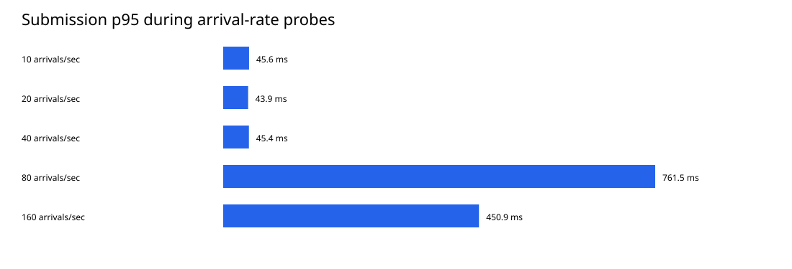
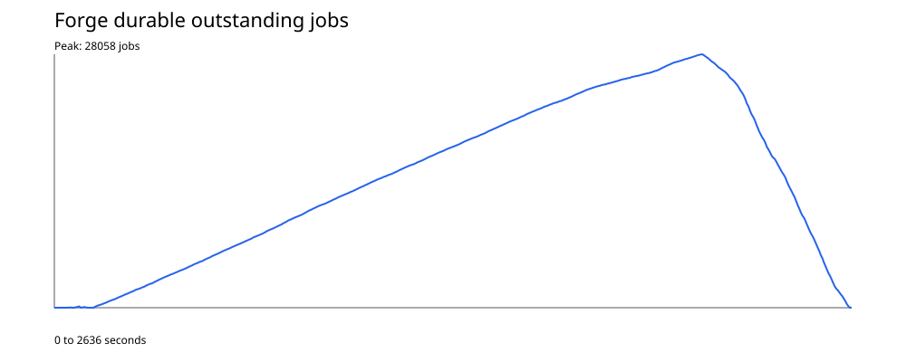
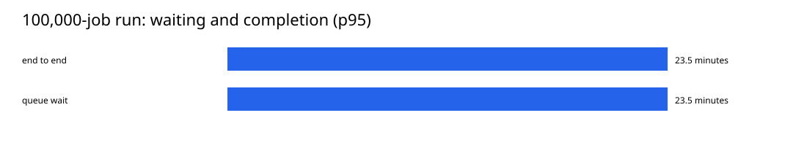
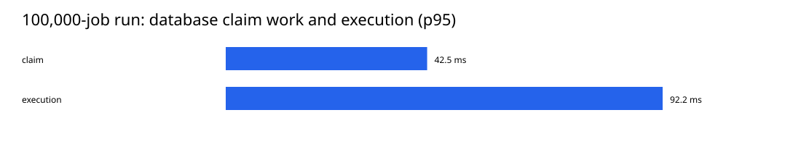
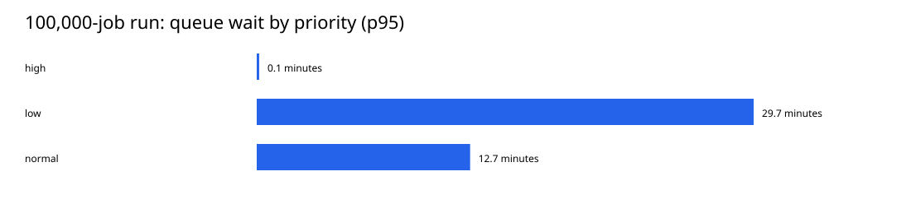
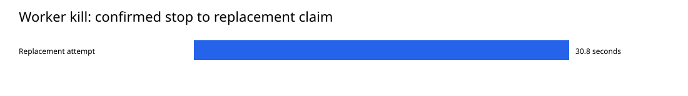

# Backend acceptance — 2026-10-05

Status: Full endurance and corrected runtime regression passed. Original
throughput and enqueue-to-claim performance targets remain unmet.

## Environment and workload

The local Linux validation stack ran on Docker Desktop with eight available CPU
cores and 8,186,892,288 bytes of VM memory. It used two API replicas, two workers
with four execution slots each, and a global concurrency limit of four for
`demo.generate_report`. PostgreSQL, Redis, S3-compatible storage, the proxy,
dispatcher, scheduler, recovery, Prometheus, Grafana and Tempo shared the machine.
Tracing and committed-transition logging were enabled.

The load generator reached the proxy over the Docker internal network. Its
container was limited to two CPU cores and 512 MB of memory. Development test
services also ran on the same host; some source checks overlapped the endurance
run. This is evidence from a shared development machine, not an isolated
production-capacity measurement.

The initial benchmark image was
`sha256:4cda82acd66ea6a9bf2a9f549ab96fcd1ffbddc9562d07b6b6e6621b9a5d672f`,
with migration head `f2c6d7e8a901`, built from uncommitted changes after `4a6bbe1`.
Subsequent source fixes protect worker trace cleanup, materialize external data
in archives, and preserve active idempotency windows during retention. An updated
image and separate regression run validate those changes without replacing the
original performance report.

Every workload job went through HTTP validation, the database transaction,
outbox, Redis, worker claim and persisted result. The report handler returns
small deterministic JSON and a suggested artifact path; it does not generate a
PDF or write that artifact. These timings describe coordination with cheap
handlers. They do not predict the cost of real report generation.

## Stepped arrival-rate probes

Each step lasted 15 seconds with a maximum of 128 virtual users. The submission
check required more than 99% acceptance, less than 1% failed requests, p95 below
500 ms, and zero dropped generator arrivals. Steps were drained before moving on.

| Offered arrivals/sec | Accepted | HTTP 503 | Dropped arrivals | HTTP p95 | Submission check |
|---:|---:|---:|---:|---:|---|
| 10 | 151 | 0 | 0 | 45.6 ms | Passed |
| 20 | 301 | 0 | 0 | 43.9 ms | Passed |
| 40 | 601 | 0 | 0 | 45.4 ms | Passed |
| 80 | 415 | 770 | 15 | 761.5 ms | Failed |
| 160 | 726 | 1,629 | 46 | 450.9 ms | Failed |

The generator can launch an additional iteration at a duration boundary; these
short-run counts should not be treated as exact sustained rate limits. Every
accepted job in these steps succeeded, and no unexpected 5xx responses occurred.
The original summary field `dependency_errors` counts **all HTTP 503 responses**;
it does not distinguish pool contention, admission rejection and dependency
outage. The script now names that counter `service_unavailable`.

Forty arrivals/sec was the highest passing step. Fifteen seconds of success
does not establish a production throughput ceiling or a sustained guarantee.

## Burst and original throughput hypothesis

| Three-second probe | Planned arrivals | Accepted | HTTP 503 | Dropped arrivals | HTTP p95 |
|---|---:|---:|---:|---:|---:|
| 10× passing step: 400/sec | 1,200 | 87 | 1,108 | 8 | 504.1 ms |
| PRD hypothesis: 1,000/sec | 3,000 | 52 | 1,296 | 1,651 | 889.8 ms |

Both submission checks failed. All 139 accepted jobs succeeded with zero
unexpected server errors. That establishes accepted-work correctness under the
offered overload, not acceptance of the entire burst. Generator drops mean it
did not deliver the entire requested load.

The PRD proposed five workers; this environment used two. The 1,000/sec result
neither meets that target nor measures the maximum capacity of its proposed
configuration. HTTP p95 covers accepted and rejected requests together.

## Authentication cost

The real database lookup, HMAC comparison and Redis rate-limit script were
measured inside an idle API container, after ten warmups, across 500 serial
samples with pooled connections and a fresh session for each sample.

| Operation | p50 | p95 |
|---|---:|---:|
| Authentication | 1.665 ms | 2.468 ms |
| Redis rate-limit check | 0.415 ms | 0.644 ms |
| Combined | 2.077 ms | 3.090 ms |

The combined timer was measured directly, rather than summing percentiles.
It is below the draft's 5 ms hypothesis in this idle experiment. It excludes HTTP
handling, submission, session teardown and contention. It is not a claim that
authentication adds less than 5 ms to every HTTP request under load.

## Endurance

The runner submitted 100,000 distinct report IDs and idempotency keys using eight
concurrent clients, with balanced high, normal and low priority. Retryable 429,
503 and transport failures use the same request and key. An idempotent HTTP 200
can count as acceptance when a prior successful commit lost its response.

The full run passed. Exactly 100,000 jobs were stored under the test credential
and all 100,000 reached `succeeded`. Every report ID and format matched its
payload. All 100,000 jobs contributed to each duration distribution below.

- Zero exhausted submissions, zero unexpected server errors and one submission
  retry. The retry reason is not separately recorded by the generator.
- Submission phase: approximately 33.5 minutes, with 49.71 accepted logical
  jobs/sec averaged over that closed workload. HTTP p95 was 323.6 ms; the
  logical submission timer including retries had 324 ms p95.
- The capacity/authentication/endurance harness took 44 minutes 2 seconds in
  total, from 14:21:03 to 15:05:05 UTC. It includes probes and the final drain;
  it is not the duration of submission alone.
- Peak sampled durable outstanding work: 28,058 jobs. Peak sampled Redis queued
  messages: 31,338. These are different counts: delivery can be repeated, while
  database ownership prevents a duplicate valid attempt.
- The final sample had zero outstanding jobs, zero queued messages and two
  active workers. All 14 services remained online.
- Forge container identities, process start times and restart counts were
  unchanged throughout the capacity/endurance stage. Intentional failures in
  earlier stages were outside that comparison.
- All five integrity counts were zero: ownership mismatches, duplicate attempt
  numbers, expired outbox leases, missing admission slots for outstanding work,
  and retained admission slots for terminal work.
- All nine temporary credentials used by this harness were revoked.

| Duration | p50 | p95 |
|---|---:|---:|
| Database claim work | 13.866 ms | 42.493 ms |
| Execution | 28.835 ms | 92.181 ms |
| Queue wait | 173.549 sec | 1,407.567 sec (23.46 min) |
| Creation to terminal result | 173.595 sec | 1,407.639 sec (23.46 min) |

| Priority | Completed jobs | Queue-wait p95 |
|---|---:|---:|
| High | 33,334 | 8.710 sec |
| Normal | 33,333 | 764.321 sec (12.74 min) |
| Low | 33,333 | 1,779.845 sec (29.66 min) |

Incoming work exceeded execution capacity during submission. Priority favored
high-priority work; the equal offered mix is not the scheduler's `8:2:1` claim
opportunity weighting. Normal and low work accumulated, then drained after
submission ended. Every tier finished, but lower-tier opportunities do not
guarantee a short wait. This run demonstrates reliable completion under backlog,
not the 50 ms enqueue-to-claim target.

A resource snapshot at 14:41:44 UTC showed roughly 120 MiB per API, 108 MiB per
worker, 249 MiB for PostgreSQL, and 29 MiB for Redis. These are sampled container
values, not peak memory measurements or proof of a universal memory bound.











Timers overlap, and percentiles cannot be added to derive another percentile.
The separate chart scales keep short database work visible beside long queue
waits. Source reports are ignored generated files; these reviewed figures and
the measurements above preserve the results in the repository documentation.

## Final source and deployment checks

The updated source passed all 99 unit, integration, failure and contract tests,
with zero skips. Ruff passed, and strict type checking found no issues in 90
source files. The retention migration `f7a9d8e6b203` applied successfully to the
development database.

The final runtime validation image is
`sha256:7b1118fee2304228466571de54aef42ba1b58238a443c0baea068a8dbcf26a3b`,
with migration head `f7a9d8e6b203`. Its deployment acceptance passed: all 251
submissions succeeded at ten arrivals/sec for 25 seconds, HTTP p95 was 73.8 ms,
all queues drained, all 14 services were online, startup and integrity checks
passed, and the temporary credential was revoked.

A preceding candidate passed deployment and worker-kill checks but failed the
no-restart assertion during PostgreSQL shutdown. Logs showed a raw
`asyncpg.CannotConnectNowError` escaping the retry handlers before SQLAlchemy
adapted it. Accepted jobs completed and integrity checks passed, but that did
not satisfy the process-survival check. The failed report was preserved locally.

The fix recognizes the raw driver connection/shutdown family consistently in
the API and background processes. API responses stay sanitized and retryable;
maintenance now also backs off on dependency errors. A regression test additionally
proved that a failed savepoint flush must not erase the outer transaction's
committed-transition log buffer. The final source fixes both cases.

The corrected dependency repeat passed. PostgreSQL rejection times were 514,
516 and 518 ms. Four accepted jobs, including the retried rejected submission,
succeeded. During storage loss, an external payload write was rejected in 3.063
seconds without a persisted job; the accepted inline job survived five storage
failures and saved its verified external result on attempt six. Forge process
identities, start times and restart counts were unchanged in both scenarios.
Normal settings were restored, the temporary key revoked, and startup/integrity
checks passed with all services online and queues empty.

The latest worker-kill repeat passed. Attempt one became `abandoned/worker_lost`;
a different worker claimed attempt two 30.789 seconds after the confirmed kill
and completed the 45-second handler. Total measured job/test elapsed time was
80.370 seconds. Integrity checks stayed at zero and the temporary key was revoked.



The separate 5,000-job regression passed at 15:25:26 UTC:

- 5,000 accepted and 5,000 succeeded; zero mismatched results, exhausted
  submissions, retries or unexpected server errors.
- HTTP p95: 341.7 ms. Database claim-work p95: 55.3 ms. Queue-wait p95:
  90.376 seconds; creation-to-result p95: 90.453 seconds.
- Peak sampled outstanding work: 1,506 jobs.
- All six correctness checks passed, including stable Forge processes, required
  services and zero integrity violations. The final queue and outstanding counts
  were zero, and both temporary credentials were revoked.
- Total harness duration was 185.707 seconds, including idle authentication
  measurement, submission, drain and final checks.

This smaller run checks the corrected runtime. It does not replace the original
100,000-job report, repeat its capacity probes, or establish a direct performance
comparison with a different workload size/database history on a shared host.
It is saved separately as `load/results/final-regression.json`.

After the nonbehavioral exception-tuple typing cleanup, the final source was
packaged as
`sha256:4fed582b5965f040ea7cd6c6eb20a665e6960d884e3eb71be6f6bd7031ae8105`.
Both API readiness checks passed, the migration head remained `f7a9d8e6b203`,
and all five startup integrity counts were zero. This packaging check does not
relabel the preceding images' 100,000-job and 5,000-job results as new runs.

## Interpretation

The database claim-work timer excludes queue waiting, Redis reservation,
permit acquisition, the final transition flush and transaction commit. The PRD's
50 ms claim target describes **enqueue to worker claim**, so a small database
claim-work measurement does not satisfy that target. Queue wait is reported
separately. End-to-end time includes queueing and execution; execution can include
retry/recovery delays when those occur.

The test scripts distinguish correctness from performance targets. A successful
correctness exit never converts the failed 1,000/sec probes into a passing
throughput claim. Public deployment, TLS, multi-host failover, external backups
and production restore timings require the chosen hosting environment.

## Reproduce

```powershell
uv run python scripts/validate_backend.py
```

The full run takes time: it submits and verifies all 100,000 jobs before reporting
success. Use the [acceptance guide](../backend-acceptance.md) for report locations,
shorter explicitly labeled checks and definitions of each measurement.
